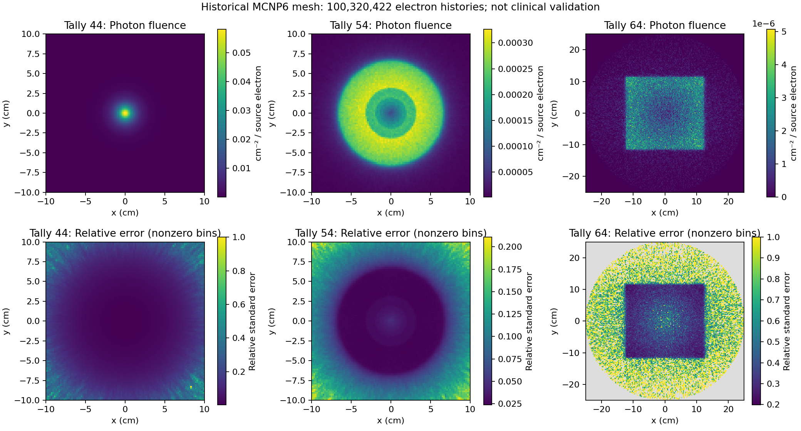

# LINAC Monte Carlo Study

[](https://github.com/jorge-barb-pereira/linac-monte-carlo-study/actions/workflows/scientific-checks.yml)

An academic medical-physics project modelling a linear accelerator treatment head, with historical MCNP inputs and maintained Python tools for source characterization and photon-fluence analysis.

**Original development: July 2021.** Preserved timestamps and MCNP run headers support this date. The maintained Python edition was developed in October 2026. [Provenance](docs/PROVENANCE.md) distinguishes original work, adaptations and excluded duplicates.

## Explore the project

| Area | Contents |
| --- | --- |
| `simulation/inputs/` | Five historical input decks: target, backing plate, collimators, flattening filter and air scoring regions |
| `src/linac_study/` | Finite-interval source probabilities, strict mesh reader and reproducible plotting CLI |
| `data/historical/` | One complete saved mesh, particle balance and extracted run diagnostics |
| `archive/` | Original planning notebook with outputs removed, historical energy plot and source hashes |
| `docs/` | Model review, provenance and validation scope |
| `tests/` | Analytic source checks, known-value mesh checks and malformed-input checks |

## Run the analysis

Requires Python 3.11 or newer. From the repository root:

```bash
python -m venv .venv
# Windows PowerShell: .venv/Scripts/Activate.ps1
# Linux/macOS: source .venv/bin/activate
python -m pip install -e .
python -m unittest discover -s tests -v
python tools/audit_sources.py
python -m linac_study
```

The command writes `output/source-distributions.png`, `output/historical-fluence.png` and `output/summary.json`. No MCNP installation is needed for postprocessing. CI runs this workflow on Python 3.11 and 3.12 and uploads the results as artifacts.



## Scientific scope

The source study uses a Cauchy energy profile centered at 6 MeV with half width 0.6 MeV, and a finite half-Cauchy radial profile with scale 0.1 cm. The maintained example integrates the CDF over each bin and normalizes over the chosen finite support; it does not silently substitute density heights for bin probabilities.

The saved mesh contains **100,320,422 electron source histories**, not the billion requested in the final input. It contains photon fluence tallies 44, 54 and 64 and their estimated relative errors. The original run was interrupted and reported statistical-check failures and random-number-stride warnings. These maps are historical descriptive results, not evidence of a commissioned clinical beam or validated dose calculation. See the [model review](docs/MODEL_REVIEW.md) before interpreting the plots.

## Simulation inputs

The original folder was named `MCNPX_CODES`; the saved mesh identifies **MCNP version 6**, and another output identifies MCNP6 1.0. These decks are preserved as historical coursework, not certified for a current MCNP release. Runtime, cross-section libraries, binary restart files and manuals are not bundled. Rerunning transport requires an independently obtained compatible installation and resolution of the review findings; CI validates Python analysis only.

The unrelated November 2023 R attenuation work in the supplied folder is already represented in [Computational Statistics & Stochastic Processes](https://github.com/jorge-barb-pereira/computational-statistics-stochastic-processes) and is not duplicated here.

## Attribution and reuse

Published as Jorge Pereira's academic portfolio. Source files do not establish sole authorship of every input geometry; collaborator and external geometry attribution remain to be confirmed. No blanket open-source license is asserted over historical coursework or third-party material. See [THIRD_PARTY_NOTICES.md](THIRD_PARTY_NOTICES.md).
